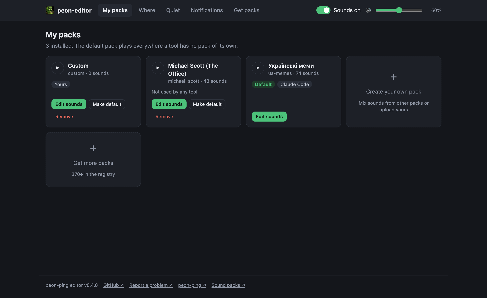
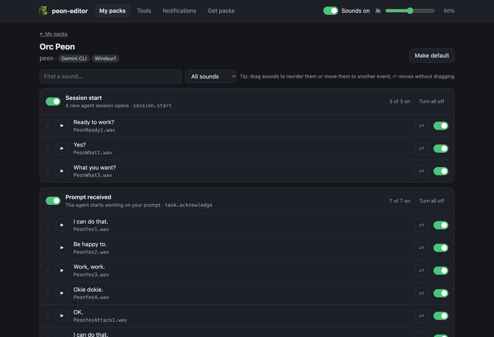
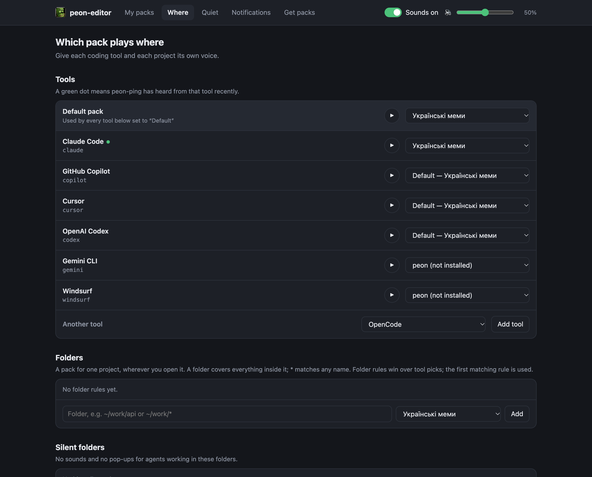
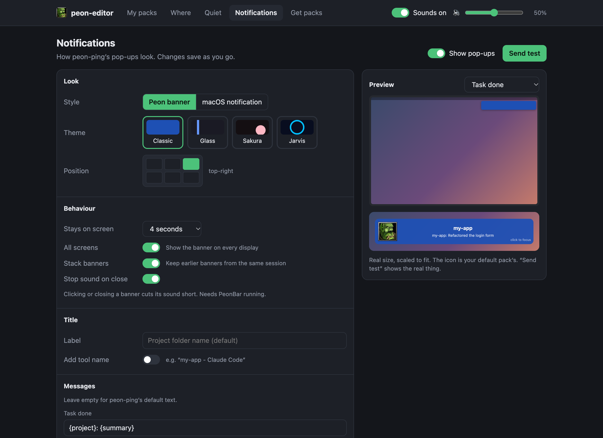
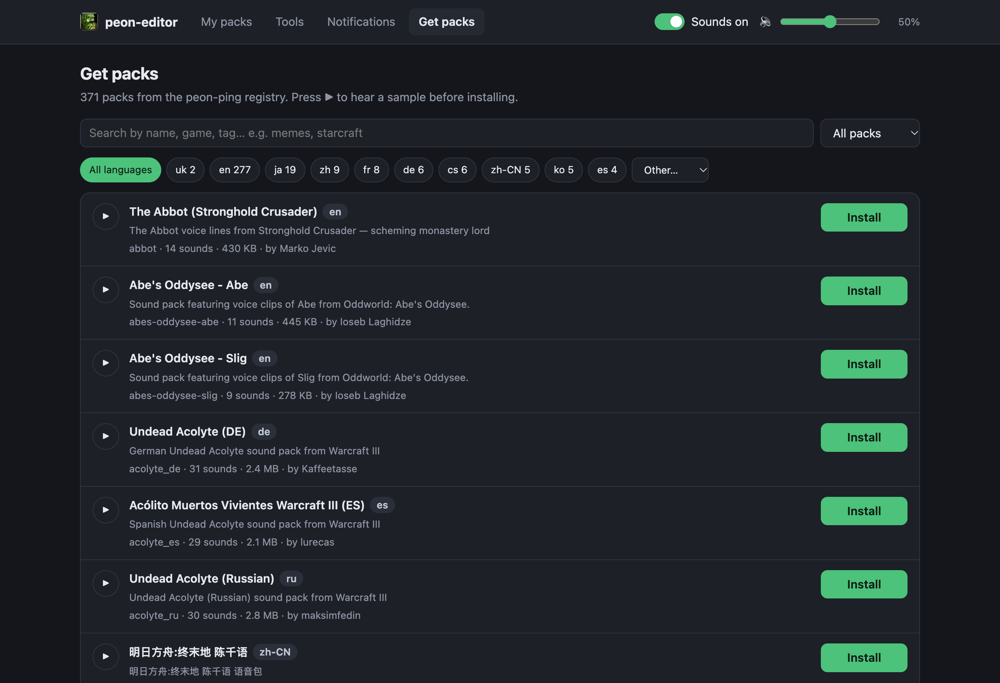

# peon-ping editor — a UI for peon-ping

A desktop UI and macOS menu-bar app for [peon-ping](https://github.com/PeonPing/peon-ping), the Warcraft-peon
(and 370+ other) voice notifications for Claude Code, GitHub Copilot, Cursor, Codex and other AI coding agents.

peon-ping is configured from the terminal. **peon-ping editor** gives it a screen: listen to and edit sound packs,
pick a different voice for each coding tool, install packs from the registry, style the pop-up notifications, and
mute or change the volume from the macOS menu bar.



## Install

You need [peon-ping](https://github.com/PeonPing/peon-ping#install) and Node.js 18+. Then one command:

```bash
curl -fsSL https://raw.githubusercontent.com/Ferosima/peon-ping-editor/main/install.sh | bash
```

It installs the editor to `~/.peon-editor`, adds a `peon-editor` command, and on macOS puts **PeonBar** in the
menu bar and starts it at every login. Run the same command again to update.

PeonBar is built on your Mac when Xcode or the Command Line Tools are installed; otherwise the installer downloads
the prebuilt app from the latest release. It shows up as **PeonBar** in System Settings → General → Login Items.

Open the editor from PeonBar → **Open pack editor…**, or run `peon-editor`.

Uninstall:

```bash
bash ~/.peon-editor/app/uninstall.sh
```

peon-ping, its settings and your sound edits stay in place.

## What you can do

| | |
|---|---|
| **My packs** | Installed packs, which tools use each one, play a sample, make one the default, remove |
| **Pack editor** | Every sound grouped by event (Session start, Task done, Needs your input, …). Turn sounds or whole events on and off, drag sounds to reorder them or drop them into another event, see files that failed to download |
| **Tools** | A different pack per tool: Claude Code, GitHub Copilot, Cursor, Codex, Gemini CLI, Windsurf, … |
| **Notifications** | Banner style and theme (Classic, Glass, Sakura, Jarvis), position, how long it stays, title, message templates. The preview matches what peon-ping draws; **Send test** shows the real one |
| **Get packs** | Browse and preview the 370+ packs in the peon-ping registry, filter by language, install with one click |
| **PeonBar** (macOS) | Menu-bar icon: sounds on/off, volume slider, default pack, open the editor, start at login |

| Pack editor | Tools |
|---|---|
|  |  |

| Notifications | Get packs |
|---|---|
|  |  |

Everything runs locally: the server listens on `127.0.0.1` only and has no dependencies.

## Usage

```
peon-editor [options]

  -p, --port <n>     Port to listen on (default 8787)
      --pack <name>  Pack to open first
      --no-open      Do not open the browser
  -v, --version      Print version
  -h, --help         Show this help
```

## How it works

The editor changes peon-ping through its own CLI wherever one exists, so peon-ping's adapters for other tools
stay in sync.

**Sounds on/off.** `peon sounds enable|disable <event> <file> --pack=<pack>` (writes `disabled_sounds` in
`config.json`; pack files are not touched).

**Moving and reordering sounds.** peon-ping has no setting for this, so the pack's `openpeon.json` is edited:

- moves and custom order are recorded in `peon-editor-moves.json` next to the peon-ping folder (`~/.claude/hooks/` by default);
- the untouched manifest is kept as `openpeon.json.orig`;
- if `peon update` overwrites the pack, your changes are applied again the next time you open it in the editor;
- each move remembers which event it came from, because packs often reuse one file in several events;
- a sound cannot be moved into an event that already plays it, and a disabled sound stays disabled after a move;
- when everything is back where it was, the manifest is restored byte-for-byte and `.orig` is removed.

**Tools.** `peon packs ide-bind <tool> <pack>`, `ide-unbind` and `packs use` (the `ide_rules` and `default_pack`
keys).

**Installing packs.** The registry is read from `https://peonping.github.io/registry/index.json` (cached for
10 minutes); installs run `peon packs install <name>`, removals `peon packs remove`.

**Mute, volume, events.** `peon pause|resume` and `peon volume <0..1>`. peon-ping has no command for turning a whole
event off, so that edits `categories` in `config.json` (it applies to every pack).

**Notifications.** On/off goes through `peon notifications on|off`; the rest (`notification_style`, `overlay_theme`,
`notification_position`, `notification_dismiss_seconds`, `notification_all_screens`, `notification_close_button`,
`notification_stacking`, `notification_title_override`, `notification_title_ide`, `notification_templates`) is
written to `config.json`. peon-ping's installer only ships the default banner, so picking Glass, Sakura or Jarvis
downloads `scripts/mac-overlay-<theme>.js` from the peon-ping release that matches your installed version.

**PeonBar.** A small Swift app (`menubar/PeonBar.swift`). The installer builds it if Xcode or the Command Line
Tools are present, otherwise it downloads the prebuilt universal app from the latest
[release](../../releases/latest). It is installed to `~/Applications/PeonBar.app` and started at login by
`~/Library/LaunchAgents/com.peonping.peonbar.plist` (toggle it in the PeonBar menu). Its menu-bar icon, like the editor's
favicon, is peon-ping's own `docs/peon-icon.png` read from your peon-ping install (dimmed and struck through
when muted); this repo ships no game artwork.

## Configuration

| Variable | Default | Meaning |
|---|---|---|
| `PEON_DIR` | `~/.claude/hooks/peon-ping` | peon-ping install dir (`CLAUDE_PEON_DIR` and `CLAUDE_CONFIG_DIR` are honoured too) |
| `PEON_EDITOR_MOVES` | `<PEON_DIR>/../peon-editor-moves.json` | where moves and custom order are stored |
| `PEON_BIN` | `peon` from `PATH` | peon CLI; set to an empty string to edit `config.json` directly |
| `PEON_EDITOR_REF` | `main` | branch or tag `install.sh` installs |
| `PEON_EDITOR_HOME` | `~/.peon-editor` | where `install.sh` puts the app |
| `PEON_EDITOR_NO_MENUBAR` | unset | `1` makes `install.sh` skip PeonBar (editor only) |

## Development

```bash
git clone https://github.com/Ferosima/peon-ping-editor && cd peon-ping-editor
npm start                 # run from the checkout
npm test                  # node:test, no dependencies
bash install.sh           # install this checkout instead of downloading
```

Releases: push a `v*` tag and GitHub Actions publishes a release with a universal `PeonBar.zip`.

---

Not affiliated with PeonPing. peon-ping and its sound packs belong to their authors.
